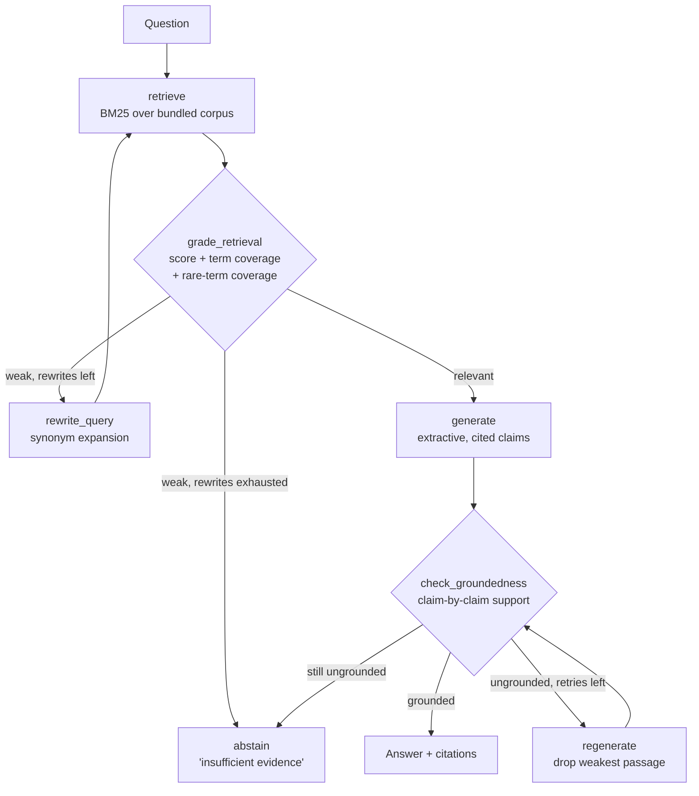

# Agentic RAG — Corrective / Self-RAG over a Bundled Corpus

## Problem statement

Plain retrieval-augmented generation fails in two predictable ways. First, the
first retrieval is often weak: the user asks in colloquial words ("how do I pay
less money for computers?") while the documents use different vocabulary
("reserved capacity", "discount"), so the generator answers from irrelevant
passages. Second, nothing checks the answer: a model can state a confident,
fluent claim that the retrieved evidence does not support, and the user has no
way to tell.

This project implements the corrective pattern end to end over a small bundled
corpus of twelve documents (cloud data platforms, telecom networks, e-commerce
operations, software engineering practices):

1. **Retrieve** passages with BM25.
2. **Grade** the retrieval for relevance — absolute score, overall term
   coverage, and coverage of the question's *distinctive* (rare) terms.
3. If the grade is weak, **rewrite the query** and re-retrieve (bounded loop).
4. **Generate** an answer with an inline citation on every sentence.
5. **Check groundedness**: every generated claim is verified against the
   retrieved evidence, numbers included.
6. If the answer cannot be grounded — or the evidence never becomes
   relevant — **abstain** with an explicit "insufficient evidence" response
   instead of guessing.

Everything runs **fully offline**: no API keys, no network, no model
downloads. Retrieval is pure-Python BM25 and the default language model is a
deterministic extractive composer (see Design decisions).

## Architecture



The graph is implemented as an explicit state machine in
`src/agentic_rag/graph.py`; each method is one node and the runner encodes
exactly the conditional edges drawn above.

## Quickstart

Requirements: Python 3.10+. There are **no runtime dependencies**.

```bash
cd agentic-rag
PYTHONPATH=src python3 -m agentic_rag "What is a canary deployment?"
PYTHONPATH=src python3 -m agentic_rag --trace "How do I pay less money for computers?"
PYTHONPATH=src python3 -m agentic_rag --eval          # evaluation harness
pip install pytest && python3 -m pytest                # test suite (8 tests)
```

Optionally `pip install .` provides the `agentic-rag` console script.

## Example output (captured from real runs)

A straightforward question:

```text
$ python -m agentic_rag "What does a data lakehouse add on top of a data lake?"
Q: What does a data lakehouse add on top of a data lake?
A: A data lakehouse combines the low-cost object storage of a data lake with the management features of a data warehouse. [02-data-lakehouse] Files remain in open formats such as Parquet, but a table format layer adds structure and guarantees on top of those files. [02-data-lakehouse] The table format layer adds transactions to the lake. [02-data-lakehouse] The same layer provides schema enforcement, which rejects writes whose columns do not match the declared table schema, and schema evolution, which allows columns to be added in a controlled way. [02-data-lakehouse] Unlike a traditional warehouse, a lakehouse keeps data in open file formats, so multiple engines — a SQL engine, a Spark job, or a machine learning training run — can read the same tables without exporting copies between systems. [02-data-lakehouse]
Citations: [02-data-lakehouse]
 grounded=True rewrites=0 generations=1 abstained=False
```

The corrective loop, visible in the trace — the first retrieval is graded
weak, the query is rewritten, and the second retrieval is strong:

```text
$ python -m agentic_rag --trace "How do I pay less money for computers?"
Q: How do I pay less money for computers?
A: Cloud bills are dominated by a small number of services, so cost optimisation starts by tagging every resource with an owner and a project. [10-cloud-cost-optimization] ... Reserved capacity is the largest single saving lever for steady workloads. [10-cloud-cost-optimization] ...
Citations: [10-cloud-cost-optimization]
 grounded=True rewrites=1 generations=1 abstained=False
Trace:
  - retrieve(query='How do I pay less money for computers?') -> [('06-ecommerce-checkout', 1.62), ('01-cloud-data-warehouse', 1.55)]
  - grade_retrieval: relevant=False (top_score=1.62 (floor 2.0), term_coverage=0.20 (floor 0.34), rare_term_coverage=0.20 (floor 0.5))
  - rewrite_query #1: 'i pay less money computer cost billing discount compute'
  - retrieve(query='i pay less money computer cost billing discount compute') -> [('10-cloud-cost-optimization', 8.23), ('01-cloud-data-warehouse', 5.21), ('06-ecommerce-checkout', 3.23)]
  - grade_retrieval: relevant=True (top_score=8.23 (floor 2.0), term_coverage=0.56 (floor 0.34), rare_term_coverage=0.50 (floor 0.5))
  - generate #1: 5 claims
  - check_groundedness: grounded=True support=[1.0, 1.0, 1.0, 1.0, 1.0]
```

An unanswerable question — the corpus contains no such statistic, so the
correct behaviour is to abstain rather than invent a number:

```text
$ python -m agentic_rag "What was the exact checkout conversion rate of the online store in March 2019?"
Q: What was the exact checkout conversion rate of the online store in March 2019?
A: Insufficient evidence: the bundled corpus does not contain enough relevant, verifiable material to answer this question.
Citations: (none — abstained)
 grounded=False rewrites=2 generations=0 abstained=True
```

Note *why* this abstains even though the question shares topical words with
the checkout document: the grader separately checks coverage of the
question's **rare terms** (idf ≥ 1.6). "exact", "conversion", "March" and
"2019" appear nowhere in the corpus, so the retrieval is graded weak no
matter how well "checkout" matches.

### Evaluation (captured output of `python -m agentic_rag --eval`)

```text
==============================================================================
Agentic RAG — evaluation report
==============================================================================
[PASS] q01 containment=1.00 citation_precision=1.00 abstained=False :: How does a cloud data warehouse separate storage and compute?
       cited: 01-cloud-data-warehouse
[PASS] q02 containment=1.00 citation_precision=1.00 abstained=False :: How long are cached query results retained in a cloud data warehouse?
       cited: 01-cloud-data-warehouse
[PASS] q03 containment=1.00 citation_precision=1.00 abstained=False :: What does a data lakehouse add on top of a data lake?
       cited: 02-data-lakehouse
[PASS] q04 containment=1.00 citation_precision=1.00 abstained=False :: How do streaming pipelines handle late-arriving events?
       cited: 03-streaming-pipelines
[PASS] q05 containment=1.00 citation_precision=1.00 abstained=False :: What is network slicing used for in 5G?
       cited: 04-telecom-5g-network
[PASS] q06 containment=0.50 citation_precision=1.00 abstained=False :: What does an OTDR measure in a fibre network?
       cited: 05-fiber-broadband-operations
[PASS] q07 containment=1.00 citation_precision=1.00 abstained=False :: Why are idempotency keys used in checkout payment requests?
       cited: 06-ecommerce-checkout
[PASS] q08 containment=1.00 citation_precision=1.00 abstained=False :: What is safety stock in inventory management?
       cited: 07-ecommerce-inventory
[PASS] q09 containment=1.00 citation_precision=1.00 abstained=False :: What is a canary deployment?
       cited: 08-cicd-practices
[PASS] q10 containment=1.00 citation_precision=1.00 abstained=False :: How large should a pull request be for an effective code review?
       cited: 09-code-review
[PASS] q11 containment=1.00 citation_precision=1.00 abstained=False :: How does reserved capacity pricing differ from on-demand pricing in cloud cost optimisation?
       cited: 10-cloud-cost-optimization
[PASS] q12 unanswerable -> abstained=True (expected abstention) :: What is the internal salary band for a senior platform engineer at the company?
[PASS] q13 unanswerable -> abstained=True (expected abstention) :: How do quantum computers use Shor's algorithm to factor large prime numbers?
[PASS] q14 unanswerable -> abstained=True (expected abstention) :: What was the exact checkout conversion rate of the online store in March 2019?
------------------------------------------------------------------------------
Questions: 14 (11 answerable, 3 unanswerable)
Mean answer containment (answerable):      0.955
Mean citation precision (answerable):      1.000
Abstention accuracy (all questions):       1.000
Abstention accuracy (unanswerable only):   1.000
==============================================================================
```

Metrics: **answer containment** = fraction of gold terms present in the
answer; **citation precision** = fraction of cited documents that are
expected sources; **abstention accuracy** = fraction of questions where the
system abstained exactly when it should have. The one imperfect score is
honest: for q06 the answer quotes the OTDR's fault-location sentence but not
the word "distance" from the following clause, so containment is 0.50.

## Repository layout

```text
data/corpus/            12 bundled documents (Markdown)
src/agentic_rag/
  corpus.py             corpus loading (doc id = filename stem)
  text.py               tokenisation + light stemming
  retrieval.py          pure-Python BM25 index
  grading.py            retrieval grading + groundedness checking
  llm.py                LLM interface, deterministic MockLLM, env adapter stub
  graph.py              the corrective graph (state machine)
  questions.py          the fixed 14-question evaluation set
  evaluation.py         eval harness and report formatting
  cli.py                `python -m agentic_rag ...`
tests/                  pytest suite (runs offline)
web/index.html          static page with a recorded run + eval summary
```

## Design decisions

- **BM25 instead of embeddings.** The corpus is small, factual and
  keyword-dense; BM25 in ~90 lines of pure Python indexes it in milliseconds
  with zero downloads. An embedding model would add a network download and a
  heavy dependency for no measurable gain at this scale.
- **Extractive MockLLM as the default model.** Answers are composed only
  from sentences that literally occur in retrieved passages, scored by
  question overlap plus a passage topic centroid (the answering sentence
  often shares few words with the question but many with the passage's
  recurring topic terms). Because generation is extractive, citations are
  exact and the groundedness check is a real verification, not theatre.
  The `LLM` protocol in `llm.py` is the seam for a real provider:
  set `AGENTIC_RAG_LLM=env` and implement `EnvLLM.generate`.
- **Rare-term coverage in the grader.** Overall term coverage alone grades
  "what was the exact conversion rate in March 2019?" as relevant because
  "checkout" matches strongly. Requiring ≥ 50% coverage of the question's
  rare terms (idf ≥ 1.6) is what makes abstention work for
  specific-but-absent facts.
- **Hand-rolled graph instead of LangGraph.** The graph's nodes and
  conditional edges mirror a LangGraph `StateGraph` one-to-one, but the
  shipped runner is a small explicit state machine. Rationale: on this
  machine `pip` is externally managed (PEP 668), and LangGraph pulls in a
  large dependency tree (langchain-core and friends, a multi-minute
  install); making it a hard dependency would break the repo's core
  promise — clone it and it runs, offline, with the standard library only.
  Porting the runner to LangGraph later is mechanical: each `_node_*`
  method becomes a graph node unchanged.
- **Bounded loops.** At most 2 query rewrites and 2 generations; a system
  that can loop forever will eventually do so on the worst possible input.
- **Deterministic synonym rewriting.** Query rewriting uses a small explicit
  synonym map (colloquial term → corpus vocabulary) instead of a model call,
  so rewrites are reproducible and unit-testable offline.

## Limitations

- Lexical retrieval cannot bridge vocabulary gaps that the synonym map does
  not cover; a question phrased with entirely unseen synonyms will abstain
  even if a document answers it in other words.
- The groundedness check is lexical too: it verifies that a claim's terms
  and numbers are supported by the evidence, but it cannot detect a claim
  that recombines supported words into a false statement.
- The extractive generator cannot synthesise across documents or do
  arithmetic; multi-hop questions ("which is cheaper, X or Y?") are out of
  scope for the mock model, though the graph and eval harness accommodate a
  real provider unchanged.
- Grader thresholds are tuned to this 12-document corpus and would need
  re-tuning (particularly the BM25 score floor) on a larger corpus.
- The evaluation set is small (14 questions) and single-source by design;
  it measures the corrective loop's behaviour, not open-domain QA quality.

## License

MIT — see `LICENSE`.
